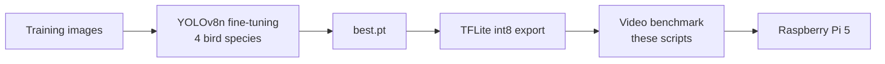

# bird-recognition-mac

The development side of my balcony bird detector: a stock detector as the baseline, then two iterations of a custom YOLOv8 model, all tested on recorded video before going to a Raspberry Pi.

## The problem

I wanted to detect birds landing on my balcony with a model small enough for a Raspberry Pi. Before putting anything on the Pi I needed a quick way to compare models on the same footage and see boxes and frame rate side by side.

## What I built

Three scripts that run a TFLite model over a video file (or a webcam), draw detections and report FPS.

| Script | Model | Notes |
|---|---|---|
| `main.py` | EfficientDet-Lite0 (COCO, stock) | Baseline. Only keeps the "bird" class. Runs with a confidence threshold of 0.025 |
| `custom_made_model/birds_best1.py` | `best_int8.tflite` | First custom YOLOv8n, four bird species. Threshold 0.30 |
| `bird_best2.py` | `best_int8_2.tflite` | Second training iteration. Prints average FPS at the end |

The first custom model is the one deployed in [custom-trained-yolov8-bird-detector-pi5](https://github.com/elie-hallermeier/custom-trained-yolov8-bird-detector-pi5).

## Architecture



Each script is the same loop: read a frame, resize to the model's input size, run the interpreter, decode the output, apply NMS, draw.

## Design decisions

- Baseline first. Running a stock COCO detector on my own footage showed what an off-the-shelf model gives before spending time on training.
- YOLOv8n on a handful of bird classes. A nano model with a narrow job is the smallest thing that works, and the YOLOv8 output is simple to decode by hand: 4 box values plus a score per class for each anchor.
- TFLite as the common format. The same `.tflite` file runs here and on the Pi, so numbers measured on the laptop are about the file that ships.
- Decoding and NMS are written out with NumPy and OpenCV instead of using the Ultralytics runtime, because the Pi runs `tflite-runtime` only.

## Setup

```bash
python3 -m venv .venv && .venv/bin/pip install -r requirements.txt
```

The test videos are not in the repo. Put your own clip next to the script and set `VIDEO_SOURCE` at the top of it, or set it to `0` to use the webcam.

## Run

```bash
.venv/bin/python bird_best2.py
```

```bash
cd custom_made_model && ../.venv/bin/python birds_best1.py
```

`main.py` also needs `efficientdet_lite0.tflite` in the repo root. Download the [EfficientDet-Lite0 detection model](https://www.kaggle.com/models/tensorflow/efficientdet/tfLite/lite0-detection-metadata) and save it under that name.

Press `q` to close the window.
